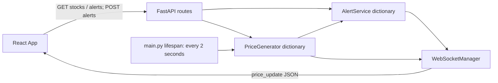
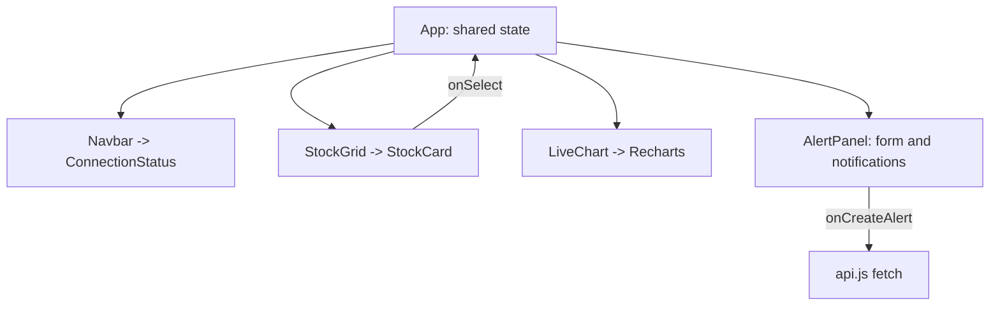
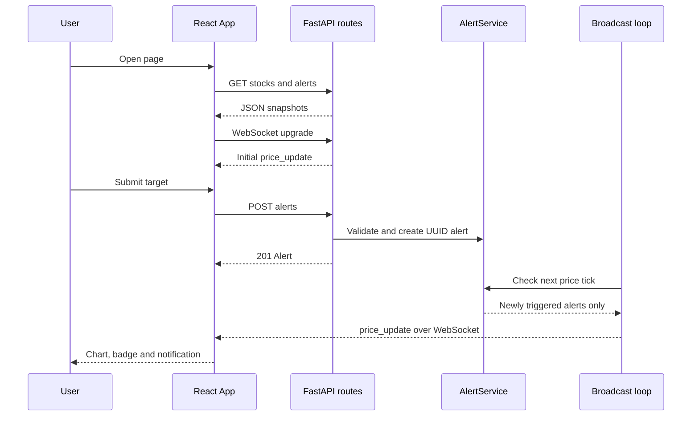
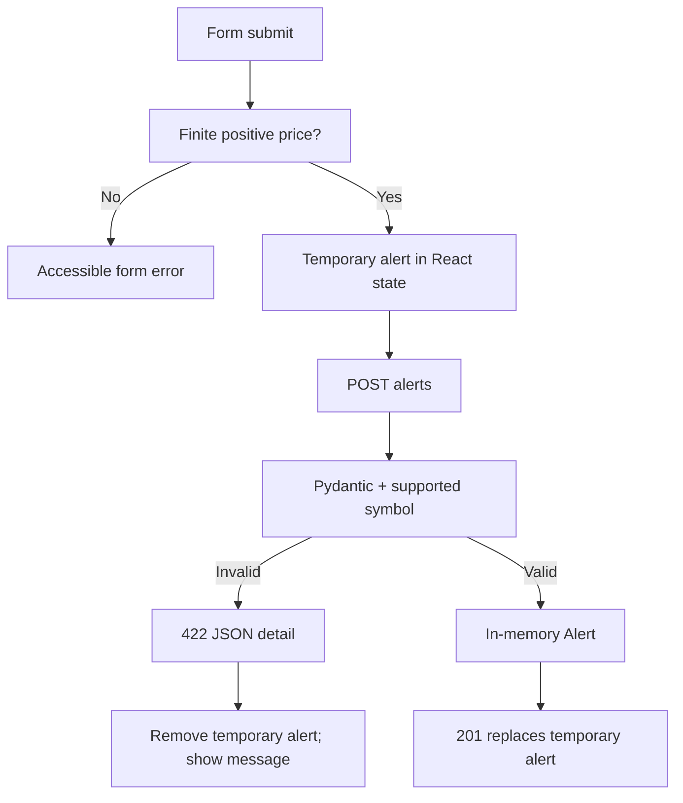
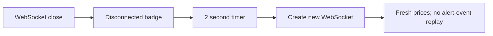

# Architecture and flows

These Mermaid diagrams describe this repository only. Database/authentication/ML diagrams
are inapplicable: those subsystems do not exist.

Backend layering is routes -> services -> Pydantic response serialization. There is no
repository/DAO layer. `main.py:19` owns the scheduler. `App.jsx:25` appends each message
to a per-symbol array and keeps the last 40 points. The initial REST and WS requests run
independently; late REST responses can temporarily overwrite fresher state. Reconnection
restores prices but does not refresh alerts, so missed notifications are not durable.
