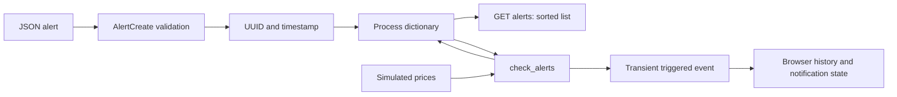

# Storage audit: no SQL database

No driver, connection URL, ORM, migrations, SQL query, disk store, transaction or foreign
key exists in the baseline. `models/schemas.py` contains validation models only.
AlertService._alerts is a Python dict keyed by UUID; values include symbol, condition,
target_price, triggered, created_at and optional triggered_at. PriceGenerator owns current
and initial prices in two dictionaries. React owns the last 40 displayed points per symbol.

Creation is approximately O(1); list sorting O(A log A); evaluation O(A) per tick;
prices O(S); broadcast O(C), where A alerts, S symbols and C clients. Storage for alerts
is unbounded; triggered entries remain in the dict. Restart loses all entries. There is
no association with an individual user, and two processes do not share state.

A future SQL exercise (not implemented): users(id), symbols(symbol), alerts(id, user_id,
symbol, condition, target_price, triggered_at). Define a foreign key from alerts to users
and symbols; parameterize queries, use transactions and index user_id/triggered status
based on measured queries. Durable event delivery additionally needs an outbox/replay
strategy; adding a table alone does not make WebSockets reliable.
